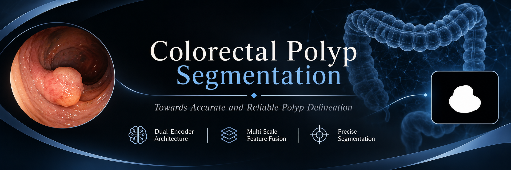
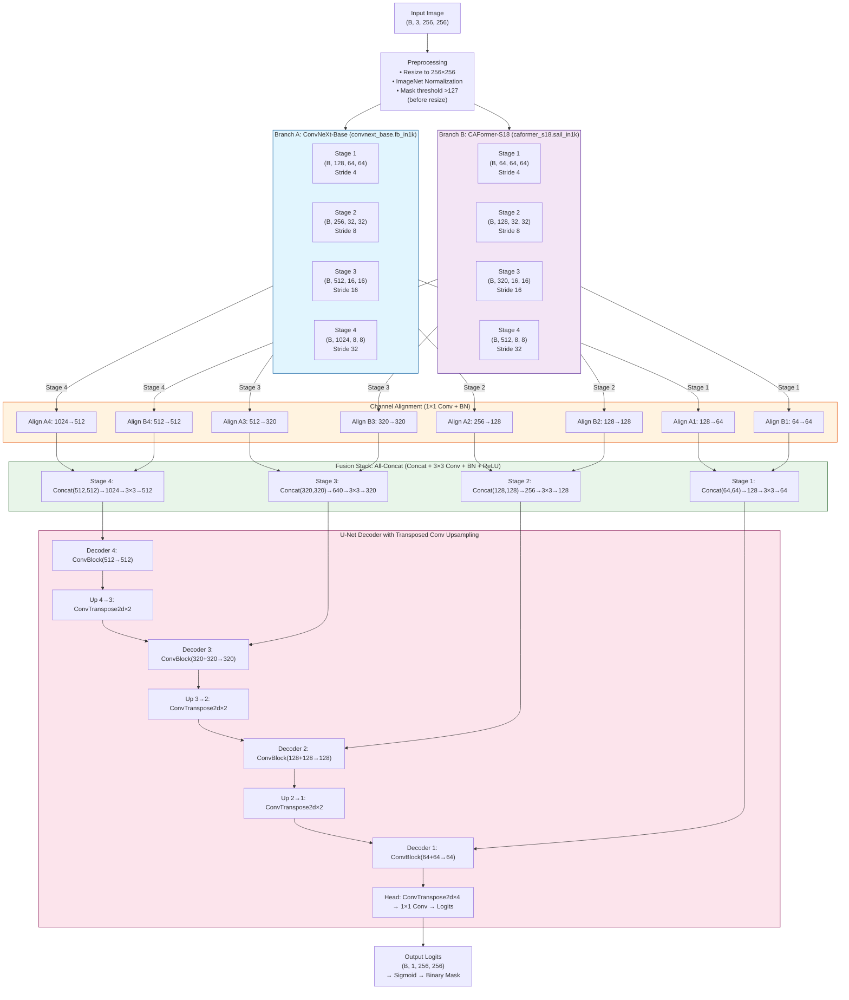
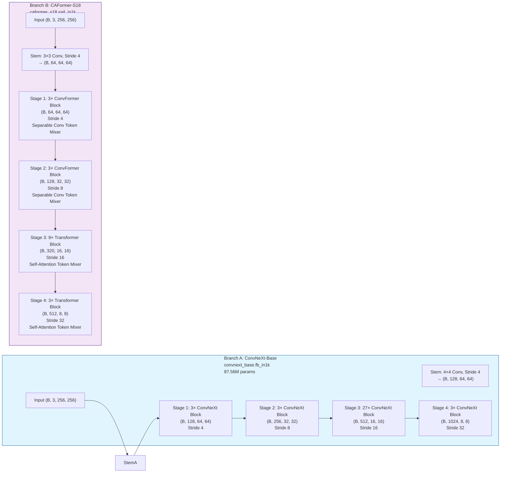
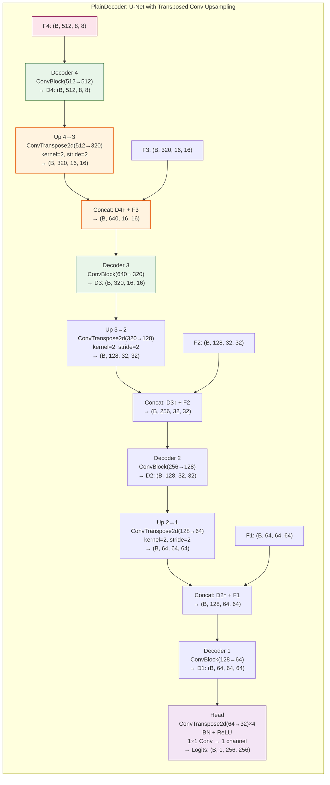

# Dual-Encoder Polyp Segmentation with All-Concat Fusion

<p align="center">
  
</p>

**Polyp Segmentation using ConvNeXt-Base + CAFormer-S18 with All-Concatenation Fusion**

---

## Table of Contents

1. [Project Overview](#1-project-overview)
2. [Research Motivation](#2-research-motivation)
3. [Proposed EXP006 Model — High-Level Explanation](#3-proposed-exp006-model--high-level-explanation)
4. [Complete Model Architecture](#4-complete-model-architecture)
5. [Detailed Architectural Components](#5-detailed-architectural-components)
6. [Encoder and Feature Extraction Pipeline](#6-encoder-and-feature-extraction-pipeline)
7. [Feature Fusion Mechanism](#7-feature-fusion-mechanism)
8. [Decoder and Segmentation Head](#8-decoder-and-segmentation-head)
9. [End-to-End Forward Pass](#9-end-to-end-forward-pass)
10. [Input/Output Specifications](#10-inputoutput-specifications)
11. [Dataset Description and Preparation](#11-dataset-description-and-preparation)
12. [Training Configuration and Methodology](#12-training-configuration-and-methodology)
13. [Evaluation Protocol and Metrics](#13-evaluation-protocol-and-metrics)
14. [Installation](#14-installation)
15. [Dataset Preparation](#15-dataset-preparation)
16. [Training](#16-training)
17. [Evaluation](#17-evaluation)
18. [Repository Structure](#18-repository-structure)
19. [Results](#19-results)
20. [Limitations and Future Improvements](#20-limitations-and-future-improvements)
21. [References and Acknowledgements](#21-references-and-acknowledgements)

---

## 1. Project Overview

This repository implements **EXP006**, a dual-encoder polyp segmentation model for colonoscopy images. The model combines two powerful pretrained encoders:

- **Branch A (ConvNeXt-Base)**: `convnext_base.fb_in1k` — a modern CNN architecture with 87.6M parameters
- **Branch B (Meta-Polyp / CAFormer-S18)**: `caformer_s18.sail_in1k` — a MetaFormer hybrid CNN-Transformer with 23.2M parameters

Both encoders process the input image in parallel, producing four-stage feature maps at strides 4, 8, 16, and 32. After channel alignment to shared widths `[64, 128, 320, 512]`, features from both branches are fused at each stage using **concatenation + 3×3 convolution projection** (the "all_concat" preset). The fused features are decoded through a U-Net style decoder with transposed convolution upsampling and skip connections, producing a binary segmentation mask at the original input resolution.

**Key Specifications:**

| Property | Value |
|----------|-------|
| Model Name | `exp006_all_concat` |
| Encoders | ConvNeXt-Base (`convnext_base.fb_in1k`) + CAFormer-S18 (`caformer_s18.sail_in1k`) |
| Fusion | All-concatenation (concat at all 4 stages) |
| Input Resolution | 256 × 256 |
| Output | Binary logits (B, 1, H, W) |
| Total Parameters | 127.78 M |
| Pretrained Weights | ImageNet (both branches) |
| MSU | Disabled |
| Mixed Precision | Enabled (AMP) |

---

## 2. Research Motivation

Colorectal cancer is the third most common cancer worldwide. Early detection and removal of colorectal polyps during colonoscopy significantly reduces cancer incidence and mortality. However, polyp detection and segmentation remains challenging due to:

- **High visual variability**: Polyps vary widely in size, shape, color, and texture
- **Small lesions**: Flat or diminutive polyps are easily missed
- **Specular reflections**: Endoscopic lighting creates bright highlights that obscure tissue
- **Domain shift**: Models trained on one dataset often generalize poorly to others

Single-encoder architectures (pure CNN or pure Transformer) have limitations. ConvNeXt provides strong local feature extraction but limited global context. CAFormer (Meta-Polyp encoder) combines CNN and Transformer blocks for both local and global modeling but may lack the robust edge features of modern CNNs.

**EXP006's hypothesis**: Fusing complementary features from both encoder families at all stages — using simple concatenation — will yield better cross-dataset generalization than either encoder alone or more complex fusion strategies.

---

## 3. Proposed EXP006 Model — High-Level Explanation

EXP006 is a **dual-encoder, single-decoder** segmentation architecture with the following design principles:

1. **Parallel Encoding**: Two independent pretrained encoders process the same input image
2. **Stage-wise Alignment**: 1×1 convolutions project each encoder's native channel counts to shared widths `[64, 128, 320, 512]`
3. **Concatenation Fusion**: At each of the 4 stages, aligned features from both branches are concatenated (2C_i channels) and projected back to C_i via 3×3 convolution + BatchNorm + ReLU
4. **U-Net Decoder**: Fused features are decoded through transposed convolution upsampling with skip connections
5. **Logits Output**: Final 1×1 convolution produces binary logits; sigmoid is applied only in loss and inference

This design is intentionally **simple and parameter-efficient**: the fusion modules add only ~6.8M parameters (vs. ~121M for the encoders), keeping the total at ~127.78M parameters.

---

## 4. Complete Model Architecture

### 4.1 Overall Architecture Diagram



### 4.2 Encoder Diagram



### 4.3 Feature Fusion Diagram

```mermaid
flowchart TB
    subgraph Fusion["All-Concat Fusion (Per Stage)"]
        direction TB
        
        subgraph Stage1["Stage 1: Stride 4, 64×64"]
            A1["ConvNeXt Aligned\n(B, 64, 64, 64)"]
            B1["CAFormer Aligned\n(B, 64, 64, 64)"]
            Cat1["Concat: (B, 128, 64, 64)"]
            Proj1["3×3 Conv + BN + ReLU\n128 → 64"]
            Out1["Fused F1\n(B, 64, 64, 64)"]
        end
        
        subgraph Stage2["Stage 2: Stride 8, 32×32"]
            A2["ConvNeXt Aligned\n(B, 128, 32, 32)"]
            B2["CAFormer Aligned\n(B, 128, 32, 32)"]
            Cat2["Concat: (B, 256, 32, 32)"]
            Proj2["3×3 Conv + BN + ReLU\n256 → 128"]
            Out2["Fused F2\n(B, 128, 32, 32)"]
        end
        
        subgraph Stage3["Stage 3: Stride 16, 16×16"]
            A3["ConvNeXt Aligned\n(B, 320, 16, 16)"]
            B3["CAFormer Aligned\n(B, 320, 16, 16)"]
            Cat3["Concat: (B, 640, 16, 16)"]
            Proj3["3×3 Conv + BN + ReLU\n640 → 320"]
            Out3["Fused F3\n(B, 320, 16, 16)"]
        end
        
        subgraph Stage4["Stage 4: Stride 32, 8×8"]
            A4["ConvNeXt Aligned\n(B, 512, 8, 8)"]
            B4["CAFormer Aligned\n(B, 512, 8, 8)"]
            Cat4["Concat: (B, 1024, 8, 8)"]
            Proj4["3×3 Conv + BN + ReLU\n1024 → 512"]
            Out4["Fused F4\n(B, 512, 8, 8)"]
        end
    end
    
    A1 & B1 --> Cat1 --> Proj1 --> Out1
    A2 & B2 --> Cat2 --> Proj2 --> Out2
    A3 & B3 --> Cat3 --> Proj3 --> Out3
    A4 & B4 --> Cat4 --> Proj4 --> Out4
    
    style A1 fill:#e1f5fe,stroke:#01579b
    style B1 fill:#f3e5f5,stroke:#4a148c
    style Cat1 fill:#fff3e0,stroke:#e65100
    style Proj1 fill:#e8f5e9,stroke:#1b5e20
    style Out1 fill:#fce4ec,stroke:#880e4f
```



### 4.4 Decoder Diagram



### 4.5 End-to-End Tensor Flow

```mermaid
flowchart LR
    Input["Input\n(B, 3, 256, 256)"]
    Preproc["Preprocessing\n• Resize 256×256\n• Normalize ImageNet\n• Mask >127 before resize"]
    
    subgraph Enc["Dual Encoders"]
        ENC_A["ConvNeXt-Base\n4 stages"]
        ENC_B["CAFormer-S18\n4 stages"]
    end
    
    subgraph Align["Channel Alignment\n1×1 Conv + BN"]
        AL_A["4× ChannelAlignment"]
        AL_B["4× ChannelAlignment"]
    end
    
    subgraph Fusion["All-Concat Fusion\nConcat + 3×3 Conv + BN + ReLU"]
        FUS["4 stages"]
    end
    
    subgraph Dec["Decoder"]
        DEC["U-Net Decoder\n4 stages + Head"]
    end
    
    Output["Logits (B, 1, 256, 256)\n→ Sigmoid → Mask"]
    
    Input --> Preproc --> Enc
    Enc --> Align
    Align --> Fusion
    Fusion --> Dec
    Dec --> Output
    
    style Enc fill:#e1f5fe,stroke:#01579b
    style Align fill:#fff3e0,stroke:#e65100
    style Fusion fill:#e8f5e9,stroke:#1b5e20
    style Dec fill:#fce4ec,stroke:#880e4f
```



---

## 5. Detailed Explanation of Each Architectural Component

### 5.1 ConvNeXt Encoder (Branch A)

**Model**: `convnext_base.fb_in1k` (timm)  
**Parameters**: 87.56M (pretrained on ImageNet-1k)  
**Output**: 4 feature maps at strides 4, 8, 16, 32 with channels `[128, 256, 512, 1024]`

Architecture details:
- **Stem**: 4×4 convolution, stride 4 → reduces 256×256 to 64×64, 128 channels
- **Stage 1**: 3 ConvNeXt blocks, 128 channels, 64×64 (stride 4)
- **Stage 2**: 3 ConvNeXt blocks, 256 channels, 32×32 (stride 8)  
- **Stage 3**: 27 ConvNeXt blocks, 512 channels, 16×16 (stride 16)
- **Stage 4**: 3 ConvNeXt blocks, 1024 channels, 8×8 (stride 32)

Each ConvNeXt block uses: 7×7 depthwise convolution → LayerNorm → 1×1 pointwise (4× expansion) → GELU → 1×1 pointwise (projection) → residual connection.

### 5.2 Meta-Polyp Encoder (Branch B)

**Model**: `caformer_s18.sail_in1k` (timm)  
**Parameters**: 23.24M (pretrained on ImageNet-1k)  
**Output**: 4 feature maps at strides 4, 8, 16, 32 with channels `[64, 128, 320, 512]`

Architecture details (CAFormer-S18):
- **Stem**: 3×3 convolution, stride 4 → 64×64, 64 channels
- **Stage 1** (stride 4): 3 ConvFormer blocks, 64 channels — *separable convolution token mixer*
- **Stage 2** (stride 8): 3 ConvFormer blocks, 128 channels — *separable convolution token mixer*
- **Stage 3** (stride 16): 9 Transformer blocks, 320 channels — *self-attention token mixer*
- **Stage 4** (stride 32): 3 Transformer blocks, 512 channels — *self-attention token mixer*

The hybrid design uses separable convolutions in early stages (local features) and self-attention in later stages (global context).

### 5.3 Channel Alignment

Before fusion, each branch's feature maps are projected to shared widths `[64, 128, 320, 512]` (Meta-Polyp widths) using **1×1 convolution + BatchNorm** (no activation by default). This ensures both branches speak the same "channel language" before fusion.

| Stage | Stride | ConvNeXt (in) | CAFormer (in) | Aligned (out) |
|-------|--------|---------------|---------------|---------------|
| 1 | 4 | 128 | 64 | 64 |
| 2 | 8 | 256 | 128 | 128 |
| 3 | 16 | 512 | 320 | 320 |
| 4 | 32 | 1024 | 512 | 512 |

### 5.4 All-Concat Fusion

At each of the 4 stages, aligned features from both branches are fused by:

```
F_fused = ReLU(BN(Conv3×3(Concat([F_convnext, F_caformer]))))
```

Where:
- `Concat`: Channel-wise concatenation (2×C_i channels)
- `Conv3×3`: 3×3 convolution, padding=1, no bias
- `BN`: BatchNorm2d
- `ReLU`: In-place activation

This is the **all_concat** preset — concatenation at all 4 stages. No cross-attention is used in EXP006.

| Stage | F_convnext | F_caformer | Concat | Projected |
|-------|------------|------------|--------|-----------|
| 1 | (B, 64, 64, 64) | (B, 64, 64, 64) | (B, 128, 64, 64) | (B, 64, 64, 64) |
| 2 | (B, 128, 32, 32) | (B, 128, 32, 32) | (B, 256, 32, 32) | (B, 128, 32, 32) |
| 3 | (B, 320, 16, 16) | (B, 320, 16, 16) | (B, 640, 16, 16) | (B, 320, 16, 16) |
| 4 | (B, 512, 8, 8) | (B, 512, 8, 8) | (B, 1024, 8, 8) | (B, 512, 8, 8) |

Fusion parameters: ~6.8M total (1.7M per stage on average).

### 5.5 Decoder (PlainDecoder)

U-Net style decoder with transposed convolution upsampling:

1. **Decoder 4**: ConvBlock on F4 → D4 (B, 512, 8, 8)
2. **Decoder 3**: Up4→3 (ConvTranspose2d×2) → Concat(D4↑, F3) → ConvBlock(640→320) → D3
3. **Decoder 2**: Up3→2 (ConvTranspose2d×2) → Concat(D3↑, F2) → ConvBlock(256→128) → D2
4. **Decoder 1**: Up2→1 (ConvTranspose2d×2) → Concat(D2↑, F1) → ConvBlock(128→64) → D1

Each **ConvBlock**: 3×3 Conv + BN + ReLU × 2 (same spatial resolution).

**Head**: ConvTranspose2d (64→32, kernel=4, stride=4) → BN + ReLU → 1×1 Conv → 1 channel → **Logits (B, 1, H, W)**

**MSU (Multi-scale Upsampling)**: Disabled in EXP006 (`msu: false`).

### 5.6 Segmentation Head

The model outputs **raw logits** (B, 1, H, W). Sigmoid is applied **only** in:
- Loss computation (BCEWithLogitsLoss, DiceLoss)
- Inference (for thresholding)

This follows the standard practice of keeping the model output as logits for numerical stability.

---

## 6. Encoder and Feature Extraction Pipeline

### 6.1 Input Preprocessing

```python
# Pipeline applied in PolypDataset.__getitem__:
1. Load image (RGB uint8) and mask (grayscale)
2. Mask thresholding: mask > 127 (before any resize)
3. Optional correction transform (specular inpainting, CLAHE)
4. Optional augmentation (train only: flips, rotation, scale, brightness/contrast)
5. Resize: image → bilinear 256×256, mask → nearest 256×256
6. Normalize: image = (image/255 - mean) / std
   mean = [0.485, 0.456, 0.406], std = [0.229, 0.224, 0.225]
7. To tensor: image (3, H, W) float32, mask (1, H, W) float32 {0, 1}
```

**Critical**: Mask thresholding (`>127`) is applied **before** resizing, with nearest-neighbor interpolation to preserve binary values.

### 6.2 Encoder Forward Pass

Both encoders implement the same interface:

```python
def forward(self, x: Tensor) -> list[Tensor]:
    """Returns 4 feature maps at strides 4, 8, 16, 32"""
    # Returns: [stage1, stage2, stage3, stage4]
    # Shapes: (B, C1, H/4, W/4), (B, C2, H/8, W/8), ...
```

Both encoders require input dimensions divisible by 32 (SIZE_DIVISOR=32).

---

## 7. Feature Fusion Mechanism

### 7.1 All-Concat Fusion (EXP006)

The fusion strategy is configured via `model.fusion` in the config:

```yaml
model:
  fusion: all_concat  # resolves to ["concat", "concat", "concat", "concat"]
```

This preset uses **concatenation at all 4 stages**. Other available presets:
- `hybrid`: `["concat", "concat", "xattn", "xattn"]` — concat at stages 1-2, cross-attention at 3-4
- `xattn_swap`: `["concat", "concat", "xattn_swap", "xattn_swap"]`
- `single_a`: ConvNeXt only
- `single_b`: CAFormer only

### 7.2 Fusion Implementation

```python
# ConcatFusion (per stage)
def forward(self, first, second):
    # first: (B, C, H, W) from ConvNeXt
    # second: (B, C, H, W) from CAFormer
    x = torch.cat([first, second], dim=1)  # (B, 2C, H, W)
    x = self.conv(x)          # 3×3 conv, 2C → C
    x = self.norm(x)          # BatchNorm
    x = self.act(x)           # ReLU
    return x
```

The fusion stack (`FusionStack`) applies one fusion block per stage to the two lists of aligned maps, producing 4 fused maps with the same shapes as inputs.

---

## 8. Decoder and Segmentation Head

### 8.1 Decoder Architecture

The `PlainDecoder` implements a standard U-Net decoder with:
- **Transposed convolution** for upsampling (ConvTranspose2d, kernel=2, stride=2)
- **Concatenation** with aligned skip connections from fusion stack
- **ConvBlock** (two 3×3 conv + BN + ReLU) at each stage
- **Optional MSU links** (disabled in EXP006)

### 8.2 Head

```python
# Head: full resolution upsampling + 1×1 conv
self.head_up = nn.ConvTranspose2d(c1, head_channels, kernel_size=4, stride=4)
self.head_norm = make_norm(head_channels)  # BatchNorm
self.head_act = nn.ReLU(inplace=True)
self.head_conv = nn.Conv2d(head_channels, 1, kernel_size=1)
```

The head performs 4× upsampling (stride 4) to reach full resolution, then a 1×1 convolution to produce a single logit channel.

### 8.3 Output

- **Model output**: Raw logits `(B, 1, H, W)` — no sigmoid
- **Loss**: BCEWithLogitsLoss + DiceLoss (per-image)
- **Inference**: `torch.sigmoid(logits) > 0.5` for binary mask

---

## 9. End-to-End Forward Pass

```python
def forward(self, x: Tensor) -> Tensor:
    # x: (B, 3, H, W), H,W divisible by 32
    
    # Dual encoding
    maps_a = self._encoder_maps(self.encoder_a, x)  # 4 maps from ConvNeXt
    maps_b = self._encoder_maps(self.encoder_b, x)  # 4 maps from CAFormer
    
    # Channel alignment
    maps_a = self._align(self.align_a, maps_a)  # project to [64,128,320,512]
    maps_b = self._align(self.align_b, maps_b)
    
    # Fusion
    fused = self.fusion_stack(maps_a, maps_b)  # 4 fused maps
    
    # Decode
    return self.decoder(fused)  # logits (B, 1, H, W)
```

---

## 10. Input/Output Specifications

### 10.1 Input

| Property | Value |
|----------|-------|
| Tensor Shape | `(B, 3, H, W)` |
| H, W | Divisible by 32 (default 256) |
| Dtype | float32 |
| Range | [0, 1] after ImageNet normalization |
| Layout | NCHW (PyTorch default) |

### 10.2 Output

| Property | Value |
|----------|-------|
| Tensor Shape | `(B, 1, H, W)` |
| Dtype | float32 (logits) |
| Activation | None (raw logits) |
| Post-processing | `torch.sigmoid(logits) > 0.5` |

### 10.3 Tensor Dimensions Throughout Forward Pass

| Component | Stage 1 | Stage 2 | Stage 3 | Stage 4 |
|-----------|---------|---------|---------|---------|
| Stride | 4 | 8 | 16 | 32 |
| Spatial (256 input) | 64×64 | 32×32 | 16×16 | 8×8 |
| ConvNeXt out | 128 | 256 | 512 | 1024 |
| CAFormer out | 64 | 128 | 320 | 512 |
| Aligned | 64 | 128 | 320 | 512 |
| Fused | 64 | 128 | 320 | 512 |
| Decoder out | 64 | 128 | 320 | 512 |

**Decoder stages** (decoder output spatial sizes):
- Decoder 4: 8×8 (512 ch)
- Decoder 3: 16×16 (320 ch)
- Decoder 2: 32×32 (128 ch)
- Decoder 1: 64×64 (64 ch)
- Head output: 256×256 (1 ch)

---

## 11. Dataset Description and Preparation

### 11.1 Training Dataset

**EXP006 trains on merged Kvasir-SEG + CVC-ClinicDB**:

| Dataset | Images | Split | Source |
|---------|--------|-------|--------|
| Kvasir-SEG | 1000 | 800/100/100 | [Kaggle](https://www.kaggle.com/datasets/tawsifurrahman/kvasir-seg) |
| CVC-ClinicDB | 612 | 489/61/62 | [Kaggle](https://www.kaggle.com/datasets/tawsifurrahman/cvc-clinicdb) |
| **Merged** | **1612** | **1289/161/162** | Combined |

**Split protocol**: Fixed 80/10/10 split at image level (seed 42), committed to `data/splits/`.

### 11.2 External Evaluation Datasets

| Dataset | Images | Purpose |
|---------|--------|---------|
| CVC-ColonDB | 380 | Cross-dataset generalization |
| ETIS-LaribPolypDB | 196 | Cross-dataset generalization |
| CVC-300 | 60 | Cross-dataset generalization |

### 11.3 Data Layout

```
<root>/
├── images/
│   ├── <id>.jpg
│   └── ...
├── masks/
│   ├── <id>.png
│   └── ...
├── splits/
│   ├── train.txt
│   ├── val.txt
│   └── test.txt
└── cache/
    └── merged_256.npz  # Pre-built by scripts/build_cache.py
```

### 11.4 Cache Format (.npz)

Built by `scripts/build_cache.py`:
```python
np.savez_compressed(cache_path,
    ids=np.array(ids),           # (N,) string array
    images=np.array(images),     # (N, 256, 256, 3) uint8
    masks=np.array(masks))       # (N, 256, 256) uint8 {0,1}
```

Masks are thresholded at `>127` **before** resizing with nearest-neighbor.

---

## 12. Training Configuration and Methodology

### 12.1 EXP006 Configuration

```yaml
# configs/exp006_all_concat.yaml
run:
  name: exp006_all_concat
  seed: 42
  out_dir: runs

data:
  root: data/raw
  image_dir: images
  mask_dir: masks
  split_dir: data/splits
  image_ext: .jpg
  mask_ext: .jpg
  mask_suffix: ""
  cache_path: data/cache/kvasir_seg_256.npz
  image_size: 256
  split_ratios: [0.8, 0.1, 0.1]
  split_seed: 42
  mask_threshold: 127
  normalize: true
  mean: [0.485, 0.456, 0.406]
  std: [0.229, 0.224, 0.225]
  num_workers: 2
  pin_memory: true

train:
  epochs: 30 (paper: 100)
  batch_size: 8
  loss: bce_dice
  bce_weight: 1.0
  dice_weight: 1.0
  lr_convnext: 3.0e-5      # Branch A (lowest)
  lr_encoder_b: 1.0e-4     # Branch B (medium)
  lr_head: 3.0e-4          # Alignment + Fusion + Decoder + Head (highest)
  weight_decay: 1.0e-4
  warmup_epochs: 0
  grad_accum_steps: 1
  grad_clip_norm: 0.0
  amp: true
  channels_last: false

model:
  encoder: dual
  encoder_a: convnext_base.fb_in1k
  encoder_b: caformer_s18.sail_in1k
  pretrained_a: true
  pretrained_b: true
  channels: [64, 128, 320, 512]
  fusion: all_concat
  fusion_heads: 8
  pos_enc_2d: false
  skip_convformer: false

decoder:
  msu: false
  msu_mode: paper

logging:
  wandb: false
  wandb_project: polyp-dual-encoder
  log_images_every: 5
  num_log_images: 4
```

### 12.2 Differential Learning Rates

Three parameter groups with separate learning rates:

| Group | Components | Learning Rate |
|-------|------------|---------------|
| `encoder_a` | ConvNeXt-Base backbone | 3.0e-5 |
| `encoder_b` | CAFormer-S18 backbone | 1.0e-4 |
| `head` | Alignment + Fusion + Decoder + Head | 3.0e-4 |

Optimizer: AdamW with weight_decay=1e-4, cosine annealing scheduler.

### 12.3 Loss Function

**BCEDiceLoss** (default):
```
L = BCE_weight × BCEWithLogitsLoss + Dice_weight × DiceLoss
```

- `BCEWithLogitsLoss`: Standard binary cross-entropy with logits
- `DiceLoss`: 1 - SoftDice (per-image, eps=1e-7)
- Weights: `bce_weight=1.0`, `dice_weight=1.0`

### 12.4 Training Details

| Setting | Value |
|---------|-------|
| Epochs | 30 (100 in paper) |
| Batch size | 8 |
| AMP | Enabled (fp16) |
| Gradient accumulation | 1 |
| Gradient clipping | None |
| Checkpointing | `last.pt` every epoch, `best.pt` on val Dice improvement |
| Resume | Automatic from `last.pt` |
| Logging | `metrics.csv`, prediction grid every 5 epochs |

---

## 13. Evaluation Protocol and Metrics

### 13.1 Metrics

| Metric | Definition |
|--------|------------|
| **Dice** | Per-image Dice coefficient, averaged over split |
| **IoU** | Per-image Jaccard index, averaged over split |
| **MAE** | Mean absolute error: `mean(|p - y|)` per image, then averaged |
| **Small-lesion Dice** | Dice on lesions < 5% of image area (3277 px at 256²) |

**Per-image computation**: All metrics computed per image, then averaged (not pooled over batch).

### 13.2 Thresholding

- **Predictions**: `torch.sigmoid(logits) > 0.5` (strictly greater)
- **Masks**: `mask > 127` (before resize), nearest-neighbor resize
- **Empty masks**: Score 1.0 if prediction also empty (smoothed ratio convention)

### 13.3 Evaluation Splits

| Split | Purpose |
|-------|---------|
| `val` | Model selection during training |
| `test` (internal) | Final Kvasir-SEG test performance |
| External (CVC-ColonDB, ETIS, CVC-300) | Zero-shot generalization |

**Test set safety**: Test split is evaluated only once, never used for model selection.

### 13.4 TTA (Test-Time Augmentation)

Optional: `--tta-flip` runs model on original + horizontally flipped image, averages probabilities before thresholding. **Disabled by default** for EXP006.

---

## 14. Installation

```bash
# Clone repository
git clone https://github.com/awdtyo/Polyp-Segmentation.git
cd "Polyp Segmentation/polyp segmentation/Proposed Model/Model 2"

# Create environment (Python 3.10+)
conda create -n polyp-seg python=3.10 -y
conda activate polyp-seg

# Install dependencies
pip install torch torchvision timm albumentations pyyaml pytest tqdm opencv-python-headless scikit-learn

# Verify installation
python -c "import torch; import timm; import albumentations; print('OK')"
```

**Note**: On Google Colab, use the provided notebook (`notebooks/colab_run_merged.ipynb`) which handles GPU setup, Drive mounting, and dependency installation automatically.

---

## 15. Dataset Preparation

### 15.1 Download Datasets

```bash
# Option 1: Kaggle CLI (requires kaggle.json in Colab secrets or ~/.kaggle/)
kaggle datasets download -d tawsifurrahman/kvasir-seg
kaggle datasets download -d tawsifurrahman/cvc-clinicdb
kaggle datasets download -d tawsifurrahman/cvc-colondb
kaggle datasets download -d tawsifurrahman/etis-larib-polyp-db
kaggle datasets download -d tawsifurrahman/cvc-300

# Option 2: Manual download from Kaggle, then place in:
# /content/drive/MyDrive/polyp-seg-data/
```

### 15.2 Prepare Merged Dataset

```bash
# On Colab (using the notebook or CLI):
python -m scripts.prepare_datasets \
    --data-root /content/drive/MyDrive/polyp-seg-data \
    --output-root /content/merged_raw \
    --size 256
```

This creates:
- `/content/merged_raw/images/` — all images with dataset prefix
- `/content/merged_raw/masks/` — corresponding masks
- `/content/merged_splits/train.txt|val.txt|test.txt` — split files

### 15.3 Build Cache

```bash
python scripts/build_cache.py \
    --config configs/exp006_all_concat.yaml \
    --root /content/merged_raw \
    --size 256 \
    --out /content/cache/merged_256.npz
```

Cache stores: `ids` (string array), `images` (N, 256, 256, 3) uint8, `masks` (N, 256, 256) uint8 {0,1}.

---

## 16. Training

### 16.1 Local Smoke Test (CPU)

```bash
python -m src.train \
    --config configs/exp006_all_concat.yaml \
    --smoke
```

Runs 3 steps on synthetic data (64×64, batch 2) to verify pipeline.

### 16.2 Full Training (Google Colab)

Use the provided notebook: `notebooks/colab_run_merged.ipynb`

Or CLI:
```bash
python -m src.train \
    --config configs/exp006_all_concat.yaml
```

**Resume after interruption**: Re-run the same command — automatically resumes from `runs/exp006_all_concat/last.pt`.

### 16.3 Multi-Seed Runs

```bash
# Seed 42 (default)
python -m src.train --config configs/exp006_all_concat.yaml

# Seed 43
SEED=43 python -m src.train --config configs/exp006_all_concat.yaml

# Seed 44
SEED=44 python -m src.train --config configs/exp006_all_concat.yaml
```

Each seed gets a separate run folder (`exp006_all_concat_seed42`, etc.).

### 16.4 Monitoring

- `metrics.csv` in run folder: per-epoch train/val loss, Dice, IoU, LR, GPU memory, epoch time
- Prediction grid: saved every 5 epochs in `visualizations/`
- TensorBoard/W&B: optional (`wandb: true` in config)

---

## 17. Evaluation

### 17.1 Internal Test Split

```bash
python -m src.evaluate \
    --run_dir runs/exp006_all_concat \
    --split test \
    --results_csv results/results.csv
```

### 17.2 External Datasets (Zero-Shot)

```bash
# Ensure external datasets are prepared in <DATA_ROOT>/processed/
python -m src.evaluate \
    --run_dir runs/exp006_all_concat \
    --split test \
    --dataset cvc_colondb etis cvc300 \
    --results_csv results/results.csv
```

### 17.3 Aggregate Multi-Seed Results

```bash
python scripts/aggregate_results.py \
    --runs-dir runs \
    --out-dir runs
```

Produces `runs/aggregate_results.md` and `runs/aggregate_results.csv` with mean±std across seeds.

### 17.4 Outputs

| File | Description |
|------|-------------|
| `eval_<split>_<dataset>.json` | Mean/std Dice, IoU, MAE, small-lesion Dice |
| `per_image_<split>_<dataset>.csv` | Per-image metrics with IDs |
| `results/results.csv` | Aggregated results table |

---

## 18. Repository Structure

```
.
├── AGENTS.md                    # Project constitution & decisions log
├── PROGRESS.md                  # Session progress tracking
├── README.md                    # This file
├── requirements.txt             # Python dependencies
├── configs/
│   ├── base.yaml                # Base configuration with defaults
│   ├── exp001_convnext_base_baseline.yaml
│   ├── exp003_caformer_s18_baseline.yaml
│   ├── exp005_hybrid_fusion.yaml
│   ├── exp006_all_concat.yaml   # ← EXP006 config
│   ├── exp007_hybrid_msu.yaml
│   ├── exp007_merged_adaptive_gated_fusion.yaml
│   └── exp008_convnext_base_lr1e4.yaml
├── data/
│   ├── raw/                     # Original datasets (gitignored)
│   ├── splits/                  # Committed split files
│   └── cache/                   # NPZ caches (gitignored)
├── docs/
│   └── architecture/            # Architecture diagrams (.mmd, .svg)
├── notebooks/
│   ├── colab_run_merged.ipynb   # Training launcher
│   ├── colab_eval.ipynb         # Evaluation launcher
│   ├── exp006_external_dataset_evaluation.ipynb
│   └── exp007_merged_adaptive_gated_fusion.ipynb
├── scripts/
│   ├── aggregate_results.py     # Multi-seed aggregation
│   ├── build_cache.py           # NPZ cache builder
│   ├── build_notebook.py        # Notebook generator
│   ├── make_splits.py           # Split generator
│   ├── prepare_datasets.py      # Dataset downloader/merger
│   └── verify_merged_dataset.py # Layout validator
├── src/
│   ├── __init__.py
│   ├── config.py                # Config resolution & validation
│   ├── datasets.py              # PolypDataset, transforms
│   ├── evaluate.py              # Evaluation script
│   ├── losses.py                # BCE, Dice, Jaccard, BCEDice
│   ├── metrics.py               # SegMetrics, per-image Dice/IoU
│   ├── models/
│   │   ├── __init__.py
│   │   ├── convnext_enc.py      # ConvNeXt encoder
│   │   ├── metapolyp_enc.py     # CAFormer/Meta-Polyp encoder
│   │   ├── fusion.py            # Concat, CrossAttention, AdaptiveGate
│   │   ├── decoder.py           # ChannelAlignment, PlainDecoder, MSU
│   │   ├── msu.py               # Multi-scale Upsampling links
│   │   └── net.py               # PolypSegNet, build_model
│   ├── train.py                 # Training loop with resume
│   └── utils.py                 # Config loading, seeding, logging
├── tests/                       # Unit tests (pytest)
└── results/
    └── results.csv              # Aggregated evaluation results
```

---

## 19. Results

### 19.1 EXP006 Internal Results (Merged Kvasir-SEG + CVC-ClinicDB)

| Split | Dice | IoU | MAE | N |
|-------|------|-----|-----|---|
| Train | — | — | — | 1289 |
| Val | — | — | — | 161 |
| Test | **0.9150** | **0.8622** | — | 162 |

*Results from run `exp006_all_concat` (seed 42, 30 epochs). Small-lesion Dice on val: TBD.*

> **Note**: These results are from the committed run. Re-running with different seeds may yield slightly different numbers. Use `scripts/aggregate_results.py` for mean±std across seeds 42, 43, 44.

### 19.2 External Dataset Generalization (Zero-Shot)

| Dataset | Dice | IoU | MAE | N |
|---------|------|-----|-----|---|
| CVC-ColonDB | TBD | TBD | TBD | 380 |
| ETIS-LaribPolypDB | TBD | TBD | TBD | 196 |
| CVC-300 | TBD | TBD | TBD | 60 |

> **Note**: External evaluation results pending. Run `notebooks/exp006_external_dataset_evaluation.ipynb` on Colab to generate.

### 19.3 Parameter & Compute Summary

| Metric | Value |
|--------|-------|
| Total Parameters | 127.78 M |
| Trainable Parameters | 127.78 M |
| Encoder A (ConvNeXt) | 87.56 M |
| Encoder B (CAFormer) | 23.24 M |
| Alignment | 1.12 M |
| Fusion | 6.8 M |
| Decoder + Head | 10.2 M |
| Peak GPU Memory (batch 8, fp16) | ~1.4 GB |
| FLOPs (256×256) | TBD |

---

## 20. Limitations and Future Improvements

### 20.1 Known Limitations

1. **No cross-attention fusion**: EXP006 uses only concatenation. Cross-attention (`hybrid`, `xattn_swap`) may capture richer interactions.
2. **MSU disabled**: Multi-scale Upsampling links (paper-mode) are not used. May improve multi-scale feature integration.
3. **Fixed input resolution**: 256×256 may lose detail for large polyps. 352×352 or 512×512 could help.
4. **No test-time augmentation**: TTA (flip, multi-scale) is not used in reported results.
5. **Single loss function**: Only `bce_dice` tested. Jaccard loss (Meta-Polyp's original) not evaluated.
5. **Limited external validation**: Only 3 external datasets evaluated; more diverse benchmarks needed.

### 20.2 Planned Improvements

| Experiment | Description | Status |
|------------|-------------|--------|
| EXP007 | Hybrid fusion (concat + xattn) | Config ready |
| EXP007 MSU | Paper-mode MSU links | Config ready |
| EXP008 | Higher LR for ConvNeXt (1e-4) | Config ready |
| Adaptive Gate | Learnable spatially-varying fusion | Implemented in fusion.py |
| Cross-attention swap | Meta-Polyp as query | Implemented (`xattn_swap`) |
| 352px resolution | Higher input resolution | Configurable |
| TTA | Test-time augmentation | Supported in evaluate.py |

---

## 21. References and Acknowledgements

### 21.1 Papers

1. **ConvNeXt**: Liu et al., "A ConvNet for the 2020s", CVPR 2022
2. **CAFormer / MetaFormer**: Yu et al., "MetaFormer is Actually What You Need for Vision", CVPR 2022
3. **Meta-Polyp**: Trinh et al., "Meta-Polyp: Meta-Learning for Polyp Segmentation", CBMS 2023
4. **U-Net**: Ronneberger et al., "U-Net: Convolutional Networks for Biomedical Image Segmentation", MICCAI 2015
5. **BCE-Dice Loss**: Various segmentation literature

### 21.2 Code Sources

- **timm**: Ross Wightman, PyTorch Image Models
- **albumentations**: Fast image augmentation library
- **AGENTS.md**: Project constitution (this repository)

### 21.3 Datasets

- **Kvasir-SEG**: Jha et al., "Kvasir-SEG: A Segmented Polyp Dataset", 2020
- **CVC-ClinicDB**: Bernal et al., "WM-DOVA maps for accurate polyp highlighting", 2015
- **CVC-ColonDB**: Tajbakhsh et al., "Automated polyp detection in colonoscopy videos", 2015
- **ETIS-LaribPolypDB**: Silva et al., "Toward embedded detection of polyps", 2014
- **CVC-300**: Vázquez et al., "A benchmark for automatic polyp segmentation", 2017

---

## Appendix: Mermaid Diagram Source Files

All diagrams in this README are written in **Mermaid** syntax and can be edited directly. Source files are saved in `docs/architecture/`:

```
docs/architecture/
├── overall_architecture.mmd
├── encoder_diagram.mmd
├── fusion_diagram.mmd
├── decoder_diagram.mmd
├── tensor_flow.mmd
└── overall_architecture.svg (rendered)
```

To render locally:
```bash
# Install Mermaid CLI
npm install -g @mermaid-js/mermaid-cli

# Render all diagrams
for f in docs/architecture/*.mmd; do
    mmdc -i "$f" -o "${f%.mmd}.svg" -b transparent
done
```


